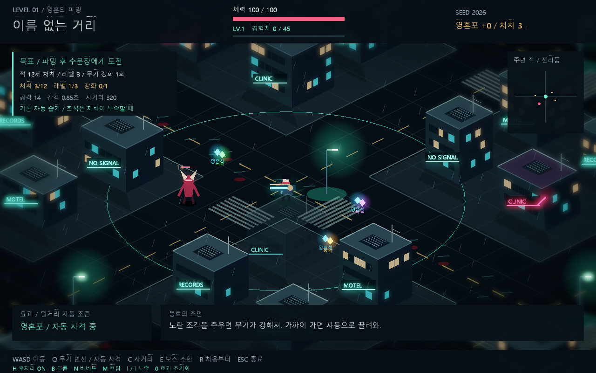
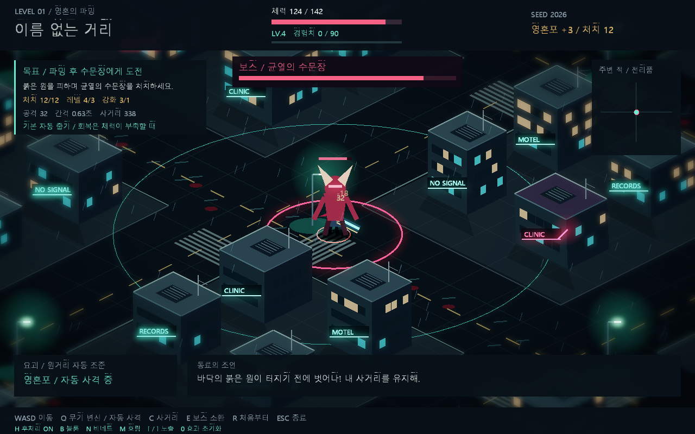

# 2026GSE01

## 2026-10-12 외곽 몬스터와 여러 마을

- 외곽 청크마다 시드 기반 랜덤 위치에 잔향귀 3~5마리를 생성합니다. 건물 내부와 마을 청크는 제외하며, 야생 몬스터는 자기 청크 밖으로 추격하지 않습니다. 처치 후 22초에 재출현합니다.
- 두 청크 간격으로 마을을 배치합니다. 초기 주변에는 시작 마을 포함 9개 마을이 있고, 각 추가 마을에는 상인·사냥꾼·경비·구도자가 있습니다. 마을 시장의 T/Y 거래와 구호소 E 치료가 가능합니다.
- 별도 상호작용 집·실내는 만들지 않습니다. 조사·거래·치료 지점은 야외 표식이며 기존 집 조사 목표도 사진 흔적 조사로 표시합니다. 배경용 건물은 유지합니다.
- 추가 마을과 야생 몬스터는 주변 5×5 청크와 함께 생성·해제됩니다. 재방문 시 같은 배치로 재생성되며 자산·체력 등의 상태 영구 저장은 아직 없습니다. 시작 마을의 기존 생활 시뮬레이션은 화면 밖에서도 유지됩니다.

[월드 확장 범위와 검증](doc/오픈월드_마을과_야생몬스터.md)

## 로컬 월드 모니터링

게임 실행 후 브라우저에서 http://127.0.0.1:8765/ 를 열면 NPC 상태, 마을별 현황, NPC·몬스터 수를 확인할 수 있습니다.
게임이 제공하는 `/api/state` JSON을 0.5초 간격으로 받아 갱신하며 별도 서버 설치는 필요하지 않습니다.

[실행 방법·JSON 규격·검증 안내](doc/로컬_월드_모니터링.md)

## 2026-10-06 플레이어 중심 지도와 원정 퀘스트

- 지도는 플레이어를 중앙에 유지하며 스트리밍된 주변 도로/건물을 연속 갱신합니다. 시작 마을 밖에서도 사용할 수 있습니다.
- 하린의 흔적을 찾는 퀘스트를 14단계로 확장했습니다. 조사/계약/사냥 → 백연에게 보고 → 시장 보급(T로 2회 판매) → 동부 중계기/신호 해독 → 지워진 역과 문지기 전투 → 기억 회수 → 묵 각성 → 최종 보고로 이어집니다.
- 역 원정은 시작 마을 동쪽의 연결 도로를 이용합니다. 금색 목표와 거리 표시를 따라가고 목표 근처에서 E를 누르세요.
- 각성 보상은 무기 강화 +1(최대 8), 동조율 +20 및 체력 회복이며 최종 보고 보상은 80전과 경험치 60입니다.

## 2026-10-02 근접 공격 모션과 도시형 맵

- 검: 준비 동작 → 크게 휘두르기 → 복귀, 청록색 잔상과 몸의 전진 모션.
- 클로: 빠른 좌우 교차 공격과 세 갈래 보라색 잔상.
- 1/3으로 선택한 후 Q로 무기화하고 왼쪽 클릭합니다. 빈 공간에서는 헛스윙만 합니다.
- 도로 폭, 필지 크기, 건물 수·높이·외벽 색을 다양화하고 보도·횡단보도·골목을 배치했습니다.
- 기존 청크 크기와 스트리밍, 메시 캐시 및 배칭을 유지합니다.

## 2026-09-28 생활형 오픈월드 — 잔명 마을

기본 실행은 주민이 사냥·거래·약탈·명상하는 상업지구 프로토타입입니다.
집과 학교에서 하린의 흔적을 찾고, 백연을 만나 묵과 계약할 수 있습니다.

- WASD 이동, E 조사/대화, Q 임시 영혼포, J 계약 후 검격
- 왼쪽 마우스 클릭: 선택한 NPC/몬스터 근접 공격. 인간 공격은 P로 PK 허용 필요.
- 1 검 / 2 원거리 / 3 클로 요괴 선택 → 항상 동행 상태로 교체 → Q 무기화. 무기화 후 클릭 공격은 선택한 형태의 사거리·공속을 사용합니다.
- T 판매, Y 회복 구매, P PK 허용, F 인간 공격, TAB 실시간 주민 목록
- 이전 파밍/보스 데모는 `--level-one`으로 실행합니다.

[구현 범위·플레이 방법·NPC 규칙·로그·검증](doc/생활형_오픈월드_프로토타입.md)

이번 버전은 생활 시뮬레이션과 조사/계약 구간이며 전체 7개 맵 캠페인과 저장은 후속 구현입니다.

## 2026-09-14 레벨 1 — 파밍과 첫 보스

C++ / OpenGL 3.3 기반 2.5D 도시 탐험 데모입니다.
`SimpleGame.sln`에서 **x64 / Debug** 또는 **x64 / Release**를 빌드해 실행합니다.

- WASD: 이동, Q: 원거리 무기 변신 / 자동 조준·사격, C: 사거리 표시
- E: 조건 달성 후 균열에서 보스 소환, R: 재시작
- 경험치 성장, 강화·회복·영혼석·자석 드랍, 랜덤 연결 도로, 보스 전투
- HDR 후처리: H 전체 전환, B 블룸, N 비네트, M 가장자리 흐림, [ / ] 노출

[레벨 1 조작·밸런스·검증 안내](LEVEL1.md)

[메시 캐시·독립 셰이더 구성 및 배포 안내](RENDERING.md)

[드로 콜 배칭·파일 캐시 개선 결과와 지속 성능 분석 리포트](docs/performance/2026-09-22-drawcall-report.md)

[Actor·SceneGraph 구조와 확장 방법](ACTOR_SCENE_GRAPH.md)

AI 대화, 영구 융합 및 저장은 후속 구현 예정입니다.
