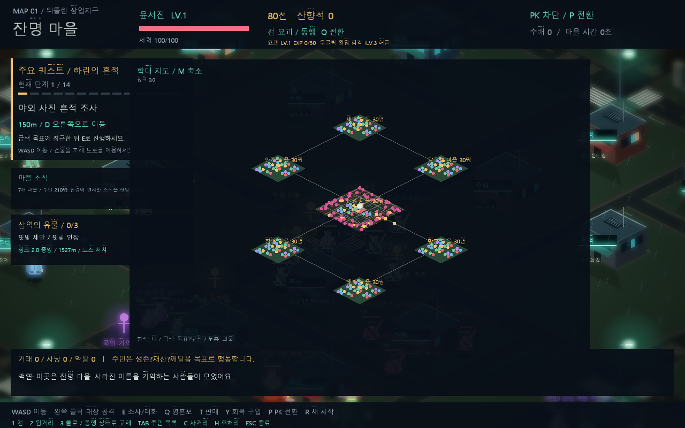
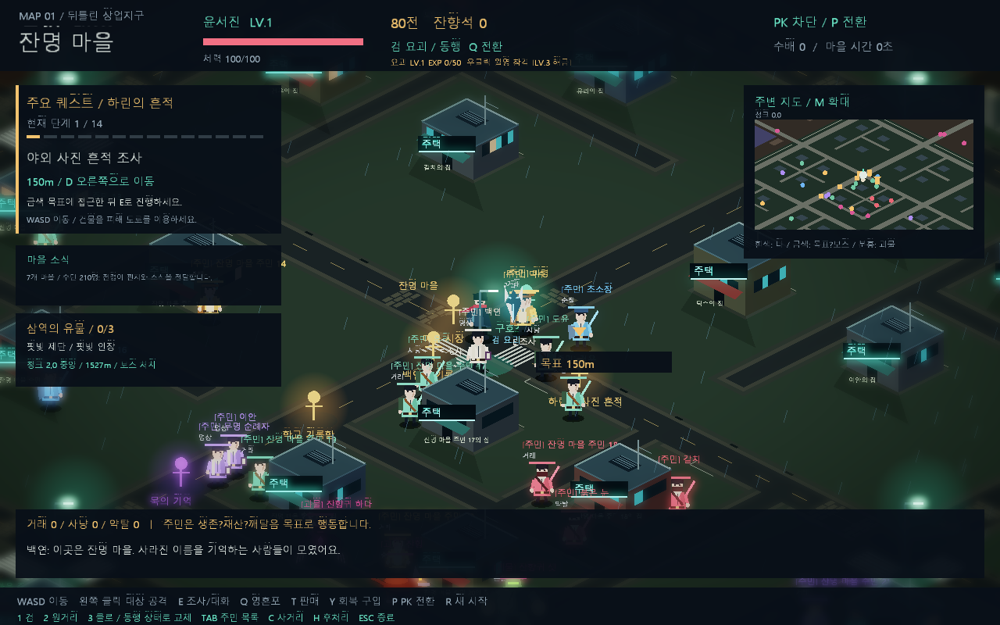

# 7개 마을과 편지·이사 시스템

## 규모와 배치

마을 하나는 3×3 청크, 약 1,920×1,920 월드 단위입니다. 예전의 작은 마을 여러 개가 차지하던 면적을 하나의 정착지로 통합했습니다. 내부 청크 사이에는 성벽을 두지 않고 정착지 외곽에만 성벽과 성문을 둡니다.

| 마을 | 중심 청크 |
| --- | --- |
| 잔명 | (0,0) |
| 황혼 | (9,0) |
| 안개 | (-9,0) |
| 청명 | (0,9) |
| 달그늘 | (0,-9) |
| 잿빛 | (9,9) |
| 새벽 | (-9,-9) |

인접 마을은 중심 기준 5,760 단위입니다. 기본 이동 속도 180에서 연결 도로를 따라 **성문에서 이웃 성문까지 약 21.6초**, 중심 교차로끼리는 약 32초입니다. 대각선이나 여러 마을을 건너는 이동은 더 오래 걸립니다. 전투·충돌·발사 정지는 이 시간에 포함하지 않습니다.

월드의 지형 스트리밍은 계속 확장되지만 정착지는 이 7개만 생성합니다. 마을 간 간선도로는 유지하고 외부 잔도로는 표시하지 않습니다. 기존 세 보스 구역은 큰 시작 마을 밖 청크 (2,0), (0,2), (-2,0)으로 옮겼습니다.

## 주민과 집

각 마을은 주민 30명으로 시작하며 총 210명입니다. 몬스터는 별도로 집계합니다. 직업은 사냥꾼·상인·구도자·경비·약탈자 등이며 마을마다 주민 중 한 명이 전령을 겸합니다.

마을마다 36채의 실제 외부 주택 건물을 배치합니다. 30채는 주민 개인에게 배정하고 6채는 전입용 빈집입니다. 집에는 소유자 이름이나 빈집 번호를 표시합니다. 입구 위치, 소유자 Actor ID, 집 슬롯을 모니터 JSON에서도 확인할 수 있습니다. 집 내부 진입 기능은 포함하지 않습니다.

주민과 소유권은 청크와 분리된 TownActor 아래에 유지되므로 화면 밖으로 나가도 사라지거나 재생성되지 않습니다. 집의 그래픽과 충돌은 지형 스트리밍 시 같은 슬롯으로 복원됩니다. 휴식은 자기 집 입구를 목표로 합니다. 주거 이동 후에는 새 집을 사용합니다.

## 소식 전달

각 마을은 자기 주민의 재산·수련·치안과 최근 살인/목격 소문을 토대로 소식을 작성합니다. 약 25초마다 유휴 전령이 있으면 인접 마을로 편지를 보냅니다. 전령은 도로·성문·미로딩 지형의 충돌 검사를 거쳐 실제로 걷습니다(속도 110). 도착 전에는 수신 마을에 정보가 추가되지 않습니다.

편지는 출발 시점의 작성 시간과 내용을 보존합니다. 도착 시 수신 마을의 알려진 소식에 반영되고 전령은 고향으로 돌아갑니다. 이동 중 쓰러지면 편지를 잃고 기존 회복 규칙을 따릅니다. 발송 간격이 전달 간격을 보장하지는 않습니다. 주민이나 전령의 화면 밖 이동도 계속 계산합니다.

발송·도착을 사건 기록과 JSONL 로그에 남깁니다. 모니터 화면에는 운반/귀환 상태와 편지 누적 발송·전달 수를 표시합니다.

## 이사 결정

주민은 자기 마을의 현재 상태와 편지로 실제 전달받은 다른 마을의 정보를 비교합니다. 재산 성향은 교역 전망, 생존 성향은 치안, 깨달음 성향은 수련 전망, 약탈 성향은 불안정한 치안에 가중치를 둡니다. 마을별 교역·수련 전망에는 초기 지역 특성도 반영됩니다. 실시간 재산·치안 변화는 다음 편지에 반영됩니다.

300초보다 오래된 소식은 이사 판단에 사용하지 않습니다. 더 좋은 평가의 마을에 빈집이 있으면 목적지 집을 예약하고 출발합니다. 한 마을에서 15초당 최대 한 명만 출발하고 전입 후에는 180초의 재이사 대기시간을 둡니다. 전령과 메인 퀘스트 기록자는 일반 이사 대상에서 제외합니다.

이동 중에는 기존 소속·집을 유지하고 목적지 집은 예약 상태입니다. 도착하면 SceneGraph 부모를 새 마을로 바꾸고 기존 집을 비운 뒤 새 집 소유권을 확정합니다. 주민 Actor를 복제하거나 도착지로 순간 이동시키지 않습니다. 이동 중 쓰러지면 목적지 예약을 해제합니다. 초기에는 마을당 30명이지만 이후 인구는 실제 이사 결과에 따라 달라지며 총 주민 수는 유지됩니다.

## 표시·모니터·성능

- M 확대 지도: 7개 마을의 위치, 연결 관계, 현재 주민 수. 기본 미니맵은 주변 청크의 상세 지형.
- NPC 머리 위: 전령/편지 운반/귀환/이사 상태.
- `/api/state`: NPC의 homeSlot, courier, migrating, travelTownIndex, letterSource; 마을별 homes, knownNews, occupiedHomes; settlementTotals의 편지 및 전입 누계.
- 사건 종류: letter_sent, letter_delivered, migration_depart, migration_arrive. 모니터 필터에서 선택 가능.
- 지면 캐시는 v10으로 갱신. 미로딩 지형 충돌 레이아웃은 최대 256청크 캐시로 제한.
- 성장·주거·편지·이사 상태는 현재 플레이 세션에만 유지되며 R 또는 게임 재실행 시 초기화.

검증 항목: 7개 마을/210명/집 배정, 편지 도착 전 정보 차단, 전령 실제 도착과 귀환, 소식 기반 이사 선택, 전입 소속과 주택 소유권 변경, 이사 중 사망 시 예약 해제, 미로딩 지형과 성문 통과, 이웃 성문 간 이동 거리, 지형 통행성과 메인 퀘스트 회귀, 모니터 HTTP JSON 및 렌더링.

## 검증 결과

Release x64 빌드, 전체 `--smoke-test`, `tests/monitor_integration.ps1` 통과. 실제 지형의 성문과 미로딩 폐허를 통과한 전령 전달, 기본 속도 기준 성문 간 약 21.6초 경로, 128개 시드/1,152개 청크 통행성, 기존 메인 퀘스트 완료 경로를 확인했습니다. 전체 렌더링 캡처에서 OpenGL 오류 0입니다.

