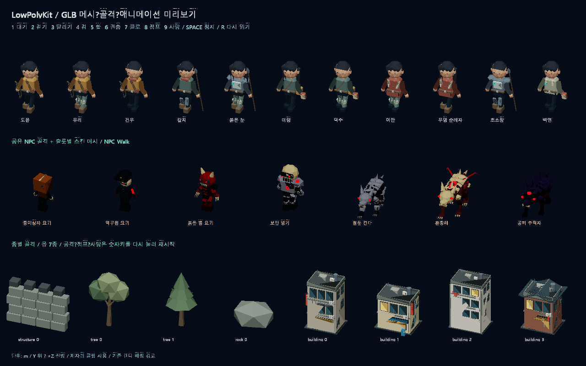
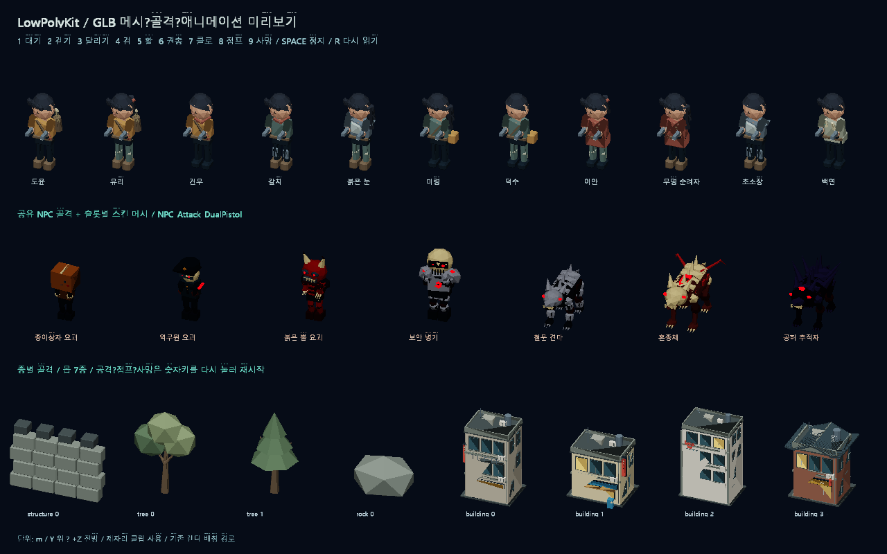

# LowPolyKit GLB 로더와 애니메이션

## 기준과 적용 범위

`Art/LowPolyKit/README.md`, `ANIMATION_README.md`와 실제 `data/` 카탈로그를 기준으로 구현했습니다. `.blend`와 제작 Python은 원본으로 보존하며 실행하거나 재생성하지 않습니다. 런타임 입력은 Blender에서 내보낸 **glTF 2.0 바이너리 GLB**입니다.

이번 구현은 재사용 가능한 로딩·애니메이션 API와 게임 렌더러를 사용하는 에셋 미리보기입니다. 현재 오픈월드 NPC와 건물은 기존 렌더링을 사용합니다. 실제 월드에 전체 적용할 때는 아트 인덱스와 게임 몬스터 타입의 명시적 대응, 크기·충돌, 공격 판정 시점과 상태 전환을 연결해야 합니다. 아트 문서에서 구분한 게임 몬스터 0/1/2와 아트 몬스터 0~6을 임의로 동일시하지 않았습니다.

## 실행

프로젝트 루트에서 Release x64 빌드 후:

```powershell
# 화면으로 확인
./x64/Release/SimpleGame.exe --asset-preview --no-monitor
# 또는
./tools/preview_lowpoly_assets.ps1

# GL 없이 전체 에셋과 애니메이션 데이터 검증
./x64/Release/SimpleGame.exe --asset-test
# 또는
./tools/preview_lowpoly_assets.ps1 -Validate

# 실제 OpenGL 렌더링, 9가지 동작 및 픽셀 변화 검사
./x64/Release/SimpleGame.exe --asset-smoke-test --no-monitor
```

기본 경로는 현재 디렉터리와 실행 파일 디렉터리의 부모를 따라 `Art/LowPolyKit`을 검색합니다. 다른 곳에 둔 키트는 `--asset-root="전체 폴더 경로"`로 지정합니다. 한글이 포함된 현재 프로젝트 경로에서 로딩을 검증했습니다. 배포 시에는 exe가 찾을 수 있는 `Art/LowPolyKit`에 `data/`, `meshes/`, `rigged/`를 함께 배치하거나 경로를 지정하십시오. Blender 설치는 필요하지 않습니다.

### 미리보기 키

| 키 | NPC 동작 | 몬스터 동작 |
| --- | --- | --- |
| 1 | 대기 | 대기 |
| 2 | 걷기 | 걷기 |
| 3 | 달리기 | 달리기 |
| 4 | 검 공격, prop 3 | 기본 공격 |
| 5 | 활 공격, prop 0 | 기본 공격 |
| 6 | 쌍권총, prop 4 | 기본 공격 |
| 7 | 클로, prop 5 | 기본 공격 |
| 8 | 점프 | 점프 |
| 9 | 사망 | 사망 |
| SPACE | 일시정지/재개 | 동일 |
| R | 카탈로그 재읽기 | 동일 |
| ESC | 종료 | 동일 |

단발 동작은 끝 자세에서 멈추며 같은 숫자키를 다시 누르면 재시작합니다. 미리보기는 대표 NPC 11명·몹 7종과 구조물/자연물/건물 표본을 표시합니다. 로더와 검증기는 카탈로그의 전체 항목을 읽습니다.

## 파일과 책임

| 소스 | 역할 |
| --- | --- |
| `AssetModel.h/.cpp` | GLB 파싱·검증, 노드와 재질, 메시·인덱스, 골격과 역바인드, 키프레임 보간, CPU 스킨 변형 |
| `AssetLibrary.h/.cpp` | 경로 탐색, JSON 카탈로그, 슬롯/프리셋, 공유 캐시, 파일 변경 감지 |
| `AssetPreview.h/.cpp` | 기존 배칭 렌더러에 입체 메시를 투영하는 어댑터와 확인 화면 |
| `AssetTests.cpp` | 실제 GLB 전체·본·클립·보간·이벤트 검증 |
| `Dependencies/AssetImport` | 버전을 고정한 cgltf 1.15, nlohmann JSON 3.12.0 및 출처/라이선스 |

프로젝트 언어 표준은 C++17입니다. 의존 헤더를 프로젝트에 포함했으므로 추가 패키지 설치나 실행 중 네트워크 다운로드가 없습니다.

## 로딩·캐시·추가 에셋

- `mesh_catalog.json`: 정적 메시의 슬롯·고정 인덱스·파일 경로.
- `animation_manifest.json`: 조립 라이브러리, NPC 완성본 경로, 몹별 경로, 클립 이름·반복·이동 속도·루트 이동·이벤트.
- `rigged_part_catalog.json`: 슬롯/인덱스에서 이름 있는 스킨 메시 노드로 연결.
- `npc_appearance_presets.json`: 프리셋 인덱스 일치 검사와 palette_index 보존.

동일 파일은 `shared_ptr<const Model>`로 공유하고 Actor별 시간/자세는 별도로 관리합니다. GLB의 파일 시간과 크기가 변하면 다음 `Load()`에서 다시 읽습니다. 변경된 파일을 읽는 중 크기나 시간이 다시 바뀌면 오류를 반환하며 기존에 반환한 모델 객체는 유효합니다. 잘못된 파일이나 카탈로그로 기존 객체를 덮어쓰지 않습니다. 오류는 미리보기 화면과 콘솔·로그에 표시됩니다.

새 파츠·환경·몹은 기존 슬롯/인덱스를 유지하고 끝에 추가합니다. 새 GLB를 먼저 완전히 내보낸 뒤 관련 JSON을 갱신하고 R 또는 `ReloadCatalogs()`를 호출하십시오. 제작 중인 파일이 부분적으로 저장된 상태에서는 검증 오류가 날 수 있으므로 저장 완료 후 다시 읽으면 됩니다. 새 본·클립·파츠 수를 현재 19본/7종에 고정하지 않았습니다.

body/hair/top/legs/feet는 필수, accessory/prop은 -1로 생략합니다. 선택한 이름의 메시만 그리며 라이브러리 전체를 동시에 표시하지 않습니다. 파츠의 공통 원점을 유지합니다. 문서에 명시된 긴 머리+화살통 조합은 겹침 방지를 위해 오류로 처리합니다. palette_index는 데이터로 보존하며 실제 색은 현재 GLB 재질의 색을 사용합니다.

## 애니메이션과 좌표

glTF의 Y 위/+Z 전방, 미터 좌표를 그대로 읽습니다. Blender 축 변환을 다시 적용하지 않습니다. 노드 계층·TRS/행렬·스킨 조인트·역바인드 행렬을 보존합니다. 스킨 정점은 `jointWorld * inverseBind`를 가중 합산하여 월드 좌표로 계산하고 메시 노드 변환을 중복 적용하지 않습니다.

시간은 초 단위입니다. 위치/크기는 선형 보간, 회전은 최단 경로 quaternion SLERP를 사용하고 STEP·CUBICSPLINE도 지원합니다. 반복은 GLB의 실제 길이를 기준으로 하며 카탈로그 반복 여부를 AnimationPlayer에 전달합니다. 비반복 동작은 마지막 자세에서 멈춥니다.

`Pose::rootDisplacement`는 클립 내부의 현재 루트 변위입니다. 기본 `removeRootMotion=true`는 본의 루트 이동을 제거하므로 Actor 이동과 중복되지 않습니다. 변위를 실제 이동에 쓰려면 호출자가 이전 변위와 반복 횟수를 추적해 충돌 이동에 반영해야 합니다. 자동으로 Actor를 이동시키지 않습니다. 방향 전환 클립의 루트 회전과 yaw_complete 이벤트는 보존하지만 Actor 방향 확정/상태 전환은 호출자가 담당합니다.

`AnimationPlayer::Advance(dt)`는 이전 시간보다 크고 새 시간 이하인 구간의 이벤트를 반환합니다. 한 프레임에서 여러 반복을 넘겨도 누락 없이 반환하고 단발 동작 종료 후 다시 발사하지 않습니다. 반환 이벤트는 연출/판정 연결용이며 로더가 직접 피해를 주거나 발사체를 만들지 않습니다.

```cpp
Art::AssetLibrary kit(Art::AssetLibrary::Discover());
auto model = kit.Load(kit.ModularFile());
auto selected = kit.SelectParts(*model, kit.Appearances().front().parts);
Art::AnimationPlayer playback;
playback.Play(kit.Animation("NPC_Walk"));
Art::Pose pose;
Art::ModelRenderer modelRenderer;

// Actor Update: events를 게임의 상태/공격 판정과 연결
auto events = playback.Advance(dt);
pose.Sample(*model, playback.Info().name, playback.Time(), playback.Info().loop);
// Actor Render: pixelsPerMeter는 게임 좌표 스케일에 맞춰 결정
modelRenderer.Draw(renderer, *model, pose, selected, {screenX, screenY}, 58.f, yaw);
```

## 현재 렌더링 범위

현재 키트의 삼각형·단색 재질·스켈레탈 애니메이션에 맞췄습니다. PBR 텍스처, 압축 메시, 모프 타깃, 외부 버퍼는 지원 대상에서 제외하고 명시적으로 오류를 반환합니다. `.gltf` 외부 파일 묶음 대신 내장 GLB를 사용합니다. UV 텍스처·물리·콜라이더·LOD·애니메이션 블렌드 트리는 후속 적용 항목입니다.

스킨 변형은 CPU에서 하고 게임의 기존 삼각형 배칭 경로로 보냅니다. 변형마다 새 GL 메시를 생성하지 않습니다. 정적 미리보기 메시의 투영 결과는 기존 메시 캐시에 넣습니다. GPU 스키닝 전용 셰이더는 구현하지 않았으며 조인트/가중치/역바인드 원본 데이터가 공개되어 향후 GPU 경로에 사용할 수 있습니다. 다수 NPC 적용 전에는 스킨 결과 공유·포즈 캐시·GPU 스키닝 성능을 별도로 측정해야 합니다.

## 검증

실제 GLB 82개 전체, 공통 NPC 파츠 조립, 7종 몹의 개별 골격, 모든 내장 클립의 샘플 자세, bind pose 일치, 루트 이동, 프레임 건너뜀 이벤트, STEP/CUBICSPLINE/회전 보간을 검증합니다. 제작 중 파일이 갱신되므로 총 정점·클립 수는 검사 시점에 따라 바뀔 수 있습니다.

검증 캡처는 실행 파일 옆의 `lowpoly-assets-pose-a/b.bmp`와 `lowpoly-assets-action-1`부터 `9.bmp`입니다. 로그의 `asset_catalog`, `asset_load`, `asset_error`에 카탈로그 수·로드 파일·오류를 기록합니다.

Release x64 빌드, `--asset-test`, `--asset-smoke-test`, 기존 게임 전체 `--smoke-test`, 실행 스크립트의 `-Validate`가 통과했습니다. 최종 에셋 검사 시점에는 GLB 82개 / 정점 188,839개 / 파일별 내장 클립 합계 330개였습니다(같은 NPC 공통 클립이 개별 프리셋 파일에도 포함되어 중복 집계됨). 원본 문서의 고유 동작 수와 이 합계를 혼동하지 않아야 합니다. NPC·몹·정적 환경을 함께 그린 9가지 동작 캡처 모두 OpenGL 오류 0, 프레임 draw call 2회였습니다. 이는 후처리를 끈 미리보기 화면의 결과이며 210명 월드 전체의 성능 수치는 아닙니다.




