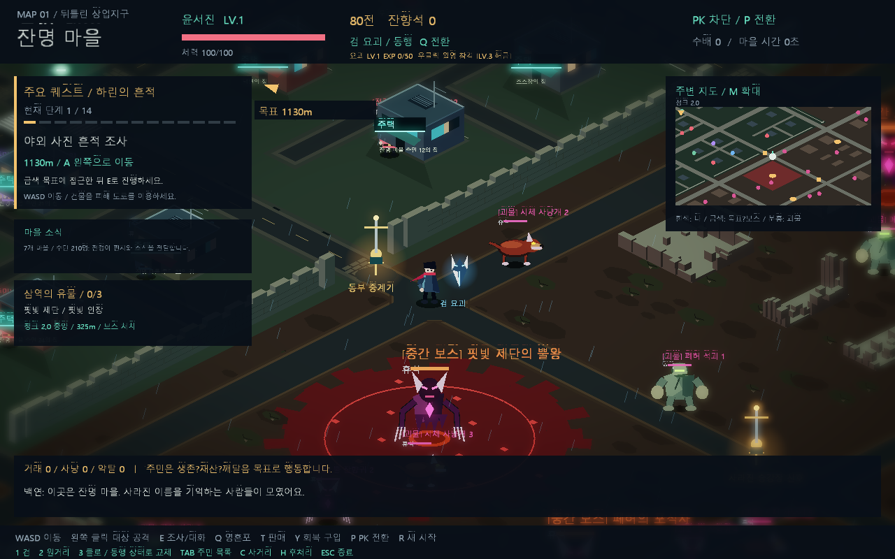

# 외곽 도로 교차로 연결 개선

첨부 화면처럼 교차로 안쪽에 다른 도로의 테두리가 남아 길이 끊겨 보이는 문제가 있었습니다. 외곽 도로를 각각 `테두리 → 도로 면` 순서로 완성하면서, 뒤에 그리는 도로의 테두리가 먼저 그린 도로를 가로질렀기 때문입니다.

전체 도로망의 바깥 흙·안쪽 갓길을 먼저 그린 후 모든 도로 면을 덮도록 변경했습니다. 교차로 네 모서리에는 짧은 사선 연결부와 동일한 겹의 갓길을 추가해, 회전 구간이 완만하게 이어지도록 했습니다. 외곽과 마을의 도로 포장색도 통일했습니다.

이동 경로·성문 위치·주택 충돌·미니맵 도로 데이터는 같은 배치를 사용합니다. 도로 장식은 기존 FloorActor 캐싱 메시에 포함되며 별도 Actor나 draw call을 추가하지 않습니다. 지면 캐시 키를 v11로 올려 이전 교차로 메시가 남지 않게 했습니다.

자동 렌더링 캡처에 `living-world-road-junction.bmp`를 추가했습니다. 기본 마을에서 동쪽 외곽 교차로까지 실제 통행로로 이동해 촬영합니다.

Release x64 빌드와 전체 smoke-test를 통과했습니다. 통행로·성문·퀘스트 회귀 테스트가 통과했고, 교차로 캡처의 OpenGL 오류는 0, 프레임 draw call은 11회입니다. 실제 캡처에서 교차부 내부 테두리가 사라지고 마을 성문과 외곽 포장이 연결되는 것을 확인했습니다.

