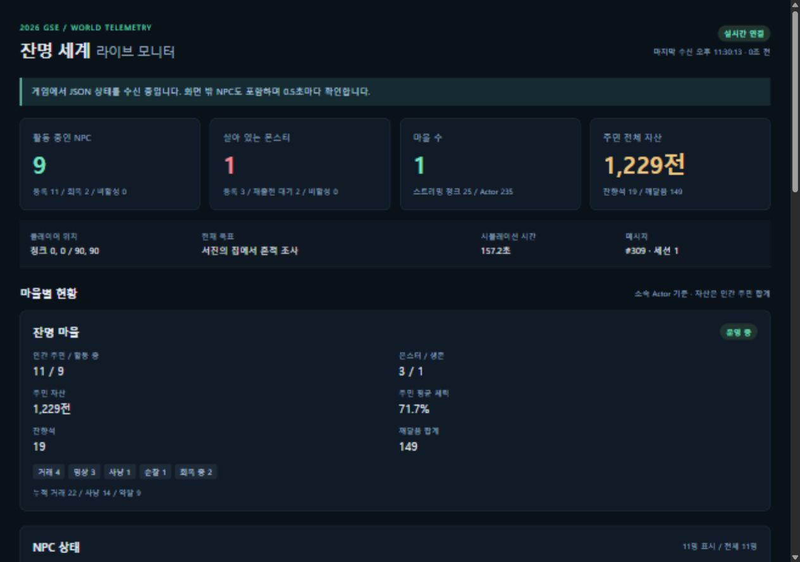

# 로컬 월드 모니터링

## 2026-10-12 사건 모니터링 확장

- 대시보드의 사건 모니터링 표에서 살인·소문을 필터링합니다. 최근 128건을 최신순으로 보관하며 누적 건수는 오래된 기록이 제외되어도 유지합니다. 월드 재시작 시 초기화됩니다.
- 살인: 인간 NPC의 체력이 공격으로 0이 된 경우만 기록합니다. 가해자(플레이어 포함), 피해자, 당시 소속 마을, 게임 내 발생 시각, 목격자를 보관합니다. 몬스터 사냥은 살인에 포함하지 않습니다. 기존 28초 회복 규칙은 유지하므로 영구 사망 구현은 아닙니다.
- 소문: 사건 발생 시 반경 180 이내의 가장 가까운 살아 있는 인간 목격자 한 명을 선정합니다. 3초 뒤에도 목격자가 활성·생존 상태이면 해당 사건의 목격담을 한 번 기록합니다. 목격자가 없거나 전달 시점에 활동할 수 없으면 소문을 만들지 않습니다. 소문은 미검증 표시이며 새로운 살인 건수로 중복 집계하지 않습니다.
- 이번 소문은 목격자 최초 전달 모델입니다. NPC 간 다단계 전파·왜곡·신뢰도 및 평판 변화는 포함하지 않습니다.
- JSON `/api/state`에 `incidents` 배열과 `incidentTotals: {murder, rumor}`를 추가했습니다. 기존 필드는 유지합니다. 각 사건에는 `id`, `type`, `simulationSeconds`, `text`, `actorId/actorName`, `victimId/victimName`, `witnessId/witnessName`, `villageId`, `sourceId`, `verified`가 있습니다. ID는 문자열이며 `0`은 없음입니다. 소문의 `sourceId`는 원본 살인 사건 ID입니다. 원본이 최근 128건에서 제외되어도 연결 ID는 유지됩니다.
- 사건은 기존 진단 JSONL의 `murder`, `rumor` 이벤트와 관련 ID를 담은 `incident_record` 이벤트에도 기록합니다. 브라우저를 닫아도 게임 내 기록은 계속 수집합니다.
- 자동 검증: 인간 제압 기록, 회복 중 중복 방지, 목격 소문 원본 연결, 한 번만 전달, 몬스터 제외, 128건 보관 및 누적 합계 유지.

## 실행

1. `SimpleGame.sln`을 x64 / Release로 빌드하거나 갱신된 `x64/Release/SimpleGame.exe`를 실행합니다.
2. 같은 PC의 브라우저에서 http://127.0.0.1:8765/ 를 엽니다.
3. 게임을 플레이하면 상태가 자동으로 갱신됩니다. HTML 파일을 직접 여는 대신 위 주소를 이용하세요.

별도 Python·Node 서버나 외부 서비스는 필요하지 않습니다. 게임에 내장된 HTTP 서버가 HTML과 JSON을 제공합니다. 서버는 127.0.0.1에만 바인딩하므로 다른 PC에 공개되지 않습니다.

포트가 사용 중이면 콘솔에 실패를 알리고 게임은 계속 실행됩니다. `--monitor-port=8775`로 포트를 바꾸면 대시보드 주소도 해당 포트로 변경됩니다. `--no-monitor`는 서버를 끕니다.

## 화면

- 전체 현황: 활동 NPC, 등록 NPC, 회복/비활성 NPC, 살아 있는 몬스터, 등록 몬스터, 재출현 대기, 마을 수, 청크 수, 주민 자산.
- 마을별 현황: 인간 주민·몬스터 수, 자산·물품·깨달음 합계, 평균 체력, 행동 분포, 누적 거래·사냥·약탈.
- NPC 목록: 이름, 직업, 행동, 체력, 자산, 물품, 깨달음, 생존/회복 상태. 마을·직업 필터 및 이름 검색을 제공합니다.
- NPC 선택: 행동 가중치, 공격 대상 Actor ID, 성장, 승리 횟수, 위치, 범죄 상태를 표시합니다.
- 몬스터 목록: 체력, 재출현 시간, 위치, 문지기 구분.
- 플레이어 위치, 현재 퀘스트, 최근 이벤트, 수신 JSON 원문 및 JSON 다운로드.

2026-10-12 월드 확장 이후 초기 스트리밍 범위에는 실제 마을 9개가 있습니다. 집계는 SceneGraph의 TownActor 소속을 기준으로 각 마을을 구분합니다. 야생 몬스터는 마을 미소속으로 표시하며 이동에 따라 생성·해제되는 추가 마을도 목록에 반영합니다.

## JSON 수신 규격

`GET http://127.0.0.1:8765/api/state`

응답은 UTF-8 `application/json`입니다. 브라우저가 500ms 간격으로 요청하는 HTTP 폴링 방식이며 WebSocket이나 서버 푸시 방식은 아닙니다. 예시의 항목들은 실제 응답 중 일부입니다.

```json
{
  "type": "world_snapshot",
  "schemaVersion": 1,
  "sessionId": "프로세스ID-시작시각",
  "sequence": 1,
  "worldEpoch": 1,
  "simulationSeconds": 0.5,
  "counts": {
    "npcs": 11,
    "npcsAlive": 11,
    "npcsRecovering": 0,
    "npcsInactive": 0,
    "monsters": 3,
    "monstersAlive": 3,
    "monstersRecovering": 0,
    "monstersInactive": 0
  },
  "villages": [],
  "npcs": [],
  "monsters": []
}
```

실제 응답에는 마을·NPC·몬스터 배열과 `generatedAtUnixMs`, `mode`, `seed`, `economy`, `actorCount`, `residentChunks`, `sites`, `events`, `player`, `quest`도 포함됩니다. 초기 상태를 아직 받지 못했을 때는 `type: waiting`을 반환합니다.

NPC 상세 항목은 `id`, `villageId`, `name`, `job`, `action`, `health`, `maxHealth`, `active`, `alive`, `recoverySeconds`, `gold`, `goods`, `insight`, `growth`, `victories`, `hostile`, `offender`, `guardian`, `targetId`, `position`, `weights`입니다. 파밍 모드 EnemyActor는 이 중 기본 상태 중심의 항목을 제공합니다.

### 집계 기준

- NPC 수는 인간 주민 수입니다. 요괴·문지기·파밍 적은 몬스터로 분리합니다.
- 등록 수는 파괴 예약되지 않은 Actor를 포함하며 비활성 Actor도 포함합니다. 생존 수는 활성 상태이면서 살아 있는 Actor입니다.
- 회복/재출현 대기와 비활성 수는 구분합니다. 처치 후 비활성화된 문지기는 등록 몬스터와 비활성 수에 남을 수 있습니다.
- 마을 자산·물품·깨달음 및 평균 체력은 소속 인간 주민 기준입니다. 체력 평균에는 회복·비활성 주민도 포함됩니다.
- 현재 거래·사냥·약탈 누적 카운터는 기존 생활 시뮬레이션의 시작 마을에 제공됩니다. 별도로 추가된 마을에 전용 카운터가 없으면 `activity`는 `null`입니다.
- 주민 위치는 플레이어 기준 상대 좌표입니다. 플레이어의 청크 좌표는 큰 좌표의 정밀도 손실을 막기 위해 문자열로 전달합니다. Actor ID도 문자열입니다.
- `sessionId`는 게임 실행 구분, `worldEpoch`는 월드 재생성 구분, `sequence`는 해당 서버의 메시지 증가 번호입니다.

## 구현 및 안전성

게임 스레드에서 최대 초당 2회 스냅샷을 생성하고 잠금으로 최신 JSON을 교체합니다. 서버 스레드는 Actor를 직접 읽지 않습니다. 렌더링 메시 생성이나 드로 콜을 추가하지 않습니다.

브라우저는 중복 요청을 방지하고 요청 제한 시간을 적용합니다. 3초 이상 새 상태가 없으면 지연 상태를 표시하며 연결이 끊겨도 마지막 수신 정보를 유지합니다. 텍스트는 HTML로 삽입하지 않으며 외부 CDN 의존성이 없습니다. 게임 종료 시 서버도 종료합니다.

게임 로그에는 서버 시작 주소와 `monitor_start` 진단 이벤트가 기록됩니다. 모니터링은 관찰 전용이며 NPC 상태를 수정하는 API는 없습니다.

## 검증

```powershell
.\x64\Release\SimpleGame.exe --smoke-test
pwsh -File .\tests\monitor_integration.ps1
pwsh -File .\tests\monitor_integration.ps1 -Legacy
```

통합 테스트는 별도 포트와 10초짜리 헤드리스 `--monitor-test` 실행을 사용합니다. JSON 파싱, 한글 문자열, NPC/몬스터 분리 집계, 자산 합계, 시간·메시지 갱신, HTML/CSS/JS 제공, 404/405 응답, 정상 종료와 포트 해제를 검증합니다. 일반 월드와 레벨 1 모드 모두 통과했습니다.

자동 자체 검증은 추가 마을·중첩 소속, 비활성 NPC, 파괴 예약 제외, JSON 문자 이스케이프, 비정상 숫자 처리를 포함합니다. 브라우저에서 목록 필터와 상세 선택, 넓은 화면·좁은 화면 레이아웃도 확인했습니다.


