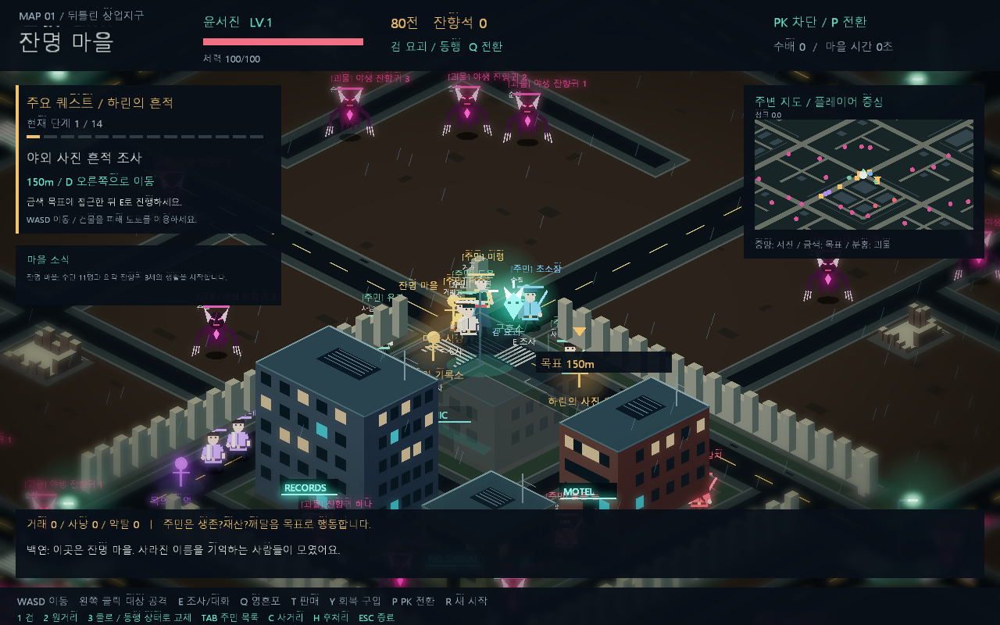

# 여러 마을과 야생 몬스터 — 2026-10-12

## 2026-10-13 중간 보스와 대형 폐허

- 외곽 청크 시드의 약 1/3에서 첫 몬스터를 중간 보스 ‘폐허의 포식자’로 배치합니다. 일반 몬스터 슬롯을 대체하므로 청크당 전체 3~5마리 상한은 유지합니다. 마을에는 생성하지 않습니다.
- 보스는 체력 360, 접촉 공격 18(공격 간격 1.4초), 추격 감지 거리 190, 보상 65전·잔향석 5개·경험치 80입니다. 처치 후 90초에 재출현합니다. 주민 사냥으로 처치하면 전리품은 해당 주민에게 이동하며 플레이어 경험치는 지급하지 않습니다.
- 외형은 일반 몬스터의 1.6배이며 중간 보스 이름과 주황색 표식으로 구분합니다. 클릭 판정도 큰 외형에 맞춥니다. 별도 보스 패턴·광역 스킬은 아직 없으며 기존 배회·추격 전투를 강화한 필드 정예형입니다.
- 모니터 JSON 몬스터 항목의 `fieldBoss`와 목록의 ★ 표시로 식별합니다. `field_boss_spawn` 로그를 추가했습니다.
- 외곽 건물 필지의 약 80%를 폐허로 남깁니다(기존 약 33%). 폐허 최대 크기는 125×105로 확대하고 높이는 28~60 범위에서 달라집니다. 내부에 9개의 잔해 더미와 불규칙한 무너진 벽을 배치합니다. 원래 필지보다 커지지 않도록 제한해 간선 도로를 침범하지 않습니다.
- 청크 크기·스트리밍 범위와 성문 위치는 바꾸지 않았습니다. 추가 마을과 마찬가지로 스트리밍 해제 후 재방문 시 보스도 초기 상태로 재생성되며 전투 상태 영구 저장은 없습니다.

## 2026-10-13 성벽·도로 외형 정리

성벽의 높은 반복 기둥을 낮은 여장과 연속 석재 벽체로 교체하고, 교차 줄눈 및 성문 끝 기둥을 추가했습니다. 지나치게 밝은 색을 낮추었습니다. 도로는 밝은 사각 테두리를 제거하고 마을의 포장 도로와 외곽의 흙에 묻힌 낡은 도로를 구분했습니다. 외곽의 횡단보도·보도 장식·네온 가로등은 제외했으며, 성문 앞뒤에는 닳은 석재 바닥을 배치했습니다.

이번 변경은 지형 배치·충돌을 유지한 렌더링 개선입니다. 연결 도로를 곡선으로 재설계한 것은 아닙니다. 기존 통행·퀘스트·몬스터 배회 테스트를 유지하며 바닥과 성벽 메시 캐시 버전을 올려 새 외형이 적용되도록 했습니다.

## 성벽·외곽 지형·몬스터 배회 확장

- 마을 청크 둘레에 충돌 가능한 성벽과 여장을 배치했습니다. 동서남북의 출입구는 기존 간선 도로 및 보도 폭에 맞추어 열어 둡니다. 도로는 이웃 청크에서도 이어지므로 마을 간 이동이 가능합니다.
- 외곽은 갈색 황무지·평지와 낮은 폐허로 교체했습니다. 기존 빌딩 필지 중 일부만 작은 폐허로 남기고 나머지는 비웁니다. 폐허는 지붕·간판·창문이 없는 부서진 벽과 잔해 형태이며 충돌 영역이 있습니다.
- 마을 바닥은 녹회색, 외곽 바닥은 갈색으로 구분합니다. 주변 지도에도 실제 성벽·폐허의 평면 배치가 반영됩니다.
- 야생 몬스터는 이동 가능한 랜덤 지점을 골라 배회합니다. 5~10초 후 또는 도착 시 새 목표를 고르며, 기존 추격·공격·회복 규칙을 유지합니다. 자기 청크 밖으로 넘어가지 않습니다.
- 성벽·폐허는 기존 BuildingActor의 스타일로 제어합니다. 렌더링과 충돌이 같은 생성 데이터를 쓰며, 메시 캐시 키를 구분해 재사용합니다. 바닥 캐시 버전도 변경했습니다.
- 기존 퀘스트 동선과 주민 이동을 회귀 검증했습니다. 연결성 검증은 성벽이 막는 경계 전체가 아닌 네 도로 출입구가 열려 있고 내부의 이동 가능한 셀들이 연결되는지를 검사합니다. 실패 시 시드·청크·도달 셀 수·출입구 상태를 출력합니다.
- 배회 자동 검증은 플레이어 공격이 없는 상태에서 여러 야생 몬스터가 실제 이동하며 자기 청크 경계를 유지하는지 확인합니다.

## 플레이

기존 640 크기 청크와 플레이어 중심 5×5 스트리밍 범위를 유지합니다. 지도를 따라 동서남북으로 이동하면 새로운 마을과 전투 지역이 계속 이어집니다.

마을은 X/Y 청크 좌표가 모두 짝수인 곳에 배치됩니다. 마을 간 간격은 2청크(1280)이며 초기 주변에는 잔명 마을과 8개 추가 마을이 있습니다. 추가 마을 이름은 시드와 좌표에 따라 구분되며 시장 위에 표시됩니다. 각 마을에는 상인·사냥꾼·경비·구도자 4명이 배치됩니다. 주민은 거래·사냥·명상 등 기존 생활 로직을 사용합니다.

각 시장 주변에서 T로 판매, Y로 회복 재료 구매가 가능합니다. 가까운 상인의 자금·재고가 실제로 변합니다. 구호소에서 E로 치료와 기존 배상 처리를 이용할 수 있습니다.

상호작용 집이나 실내는 새로 만들지 않았습니다. 기존 시설의 작은 집 모양도 야외 표식으로 교체했습니다. 첫 퀘스트는 야외 사진 흔적 조사로 안내하며 조사 순서와 보상은 유지합니다. 일반 도시 건물은 배경·충돌용으로 남습니다.

## 몬스터

- 마을이 아닌 청크마다 3~5마리를 목표로 생성합니다. 위치·개수·체력은 청크 시드에서 결정하므로 같은 시드는 같은 배치가 됩니다.
- 최대 80번의 후보 검사로 건물과 충돌하지 않는 곳을 찾습니다. 충분한 공간을 못 찾으면 목표보다 적게 생성할 수 있습니다.
- 체력 65~110, 전리품 12전과 잔향석 1개이며 기존 클릭 공격·자동 조준·경험치·회복 로직을 사용합니다.
- 처치 후 22초에 원래 위치에서 재출현합니다. 야생 몬스터는 자신의 청크 경계를 넘지 않으므로 마을 청크로 추격해 들어오지 않습니다.
- 시작 마을의 기존 튜토리얼용 외곽 잔향귀 3체는 유지합니다. 추가 랜덤 몬스터는 마을 청크에 생성하지 않습니다.

## 구조와 범위

청크 Actor 아래에 야생 몬스터 또는 추가 TownActor와 그 주민·시설을 배치합니다. 부모 청크 해제 시 자식들도 해제되므로 끝없이 탐험해도 Actor가 방문 수만큼 계속 쌓이지 않습니다. 이미 생성된 청크에서는 중복 생성하지 않습니다.

NPC 이동 기준을 각자 부모 Actor의 좌표로 변경하고, 다른 부모의 사냥 대상은 월드 좌표를 통해 변환합니다. 목표 탐색 거리는 600으로 제한합니다. 추가 마을 주민의 비전투 활동 위치는 자신의 거점이며 사냥 시에는 주변 대상을 따라갑니다.

추가 마을과 몬스터는 활성 스트리밍 범위에서 시뮬레이션됩니다. 범위에서 벗어나 해제된 추가 마을은 재방문 시 초기 상태로 재생성됩니다. 주민 자산·사건·몬스터 재출현 타이머의 청크별 영구 저장은 후속 작업입니다. 시작 마을은 기존대로 별도 유지되어 화면 밖에서도 생활이 계속됩니다.

모니터는 실제 생성된 마을·주민·야생 몬스터를 집계합니다. 야생 몬스터는 마을 미소속으로 표시합니다. 추가 마을의 누적 거래·사냥·약탈 전용 카운터는 아직 없으며 `activity: null` 규칙을 유지합니다.

진단 로그의 `village_spawn`은 이름과 주민 수, `wild_spawn`은 청크 좌표와 생성 수를 기록합니다. 기존 Actor 배칭·메시 캐시를 사용하며 개체마다 별도 렌더러를 추가하지 않습니다.

## 검증

Release 빌드 및 전체 smoke-test를 통과했습니다. 새 검증은 초기 마을 9개, 외곽 몬스터 48마리 이상, 마을/건물 제외, 동일 시드 배치 재현, 반복 스트리밍 중복 방지를 확인합니다. 기존 180초 생활 시뮬레이션, 충돌 없는 NPC 이동, 시작 마을 화면 밖 업데이트, 확장 퀘스트 완주와 마우스 공격 검증도 통과했습니다.

모니터 통합 테스트는 초기 주민 43명, 마을 9개, 기존 3체를 포함한 몬스터 51체 이상 및 마을별 자산 합계를 검증하도록 갱신했습니다.
